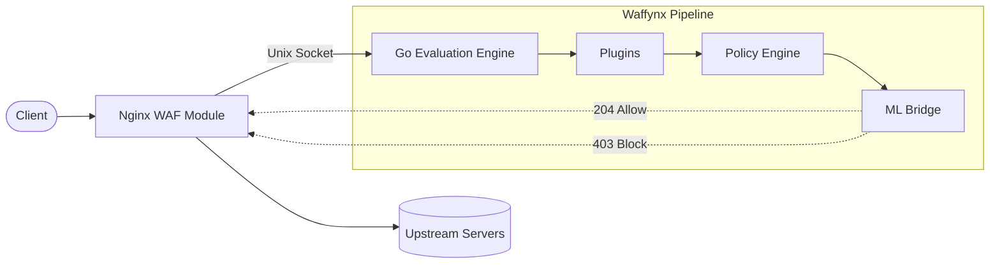

<div align="center">
  <h1>🛡️ Waffynx</h1>
  <p><b>The self-hosted Web Application Firewall that runs as one container</b></p>
  <p>Native Nginx integration • High-performance Go sidecar • Pluggable AI • No feature gating</p>
</div>

<br/>

Waffynx is a self-hosted Web Application Firewall and reverse proxy. It is meant to be
Cloudflare-WAF-grade protection on hardware you control: one container, no host
privileges, and every capability available to everyone — there is no license check,
no feature tier and no telemetry.

Requests are inspected by a native Nginx C module that hands evaluation to a
high-performance Go sidecar over a `0600` Unix socket: plugins, a policy engine and
an ML scorer, in that order.

---

## 🚀 Key Features

* **Native Nginx Integration**: Intercepts requests at the ACCESS phase with near-zero latency. Uses a heavily optimized, stripped-down Nginx binary (868KB).
* **Multi-Stage Evaluation Pipeline**: Traffic flows through a chain of dynamic plugins, a robust policy engine, and finally an ML anomaly scorer.
* **Deep Body Inspection**: Detects SQLi, XSS, Command Injection, and Path Traversal even within complex POST bodies (JSON, GraphQL, File Uploads).
* **Built-in Protection Plugins**:
  * `request-validation`: Strict schema enforcement.
  * `bot-protection`: Advanced bot mitigation.
  * `rate-limit`: Distributed token bucket (Redis-backed).
  * `geo-block`: MaxMind IP intelligence.
* **C++ Machine Learning Bridge**: Swappable ML engine (integrates with open-appsec) for behavioral entropy analysis and pattern detection.
* **Management Plane**: REST API with JWT/OIDC authentication and RBAC, a single-page control-room UI, and Prometheus metrics out of the box.
* **Privilege-free IP blocking**: bans are enforced at the WAF layer, so they work in a container with no `NET_ADMIN`. Kernel-level `nftables`/`ufw` drops are an *optional* system-mode enhancement (`waf-agent`).
* **`waffynx verify`**: a functional self-test that drives benign and malicious requests through the real inspection pipeline and reports what was blocked and why.

## 🏗️ Architecture

Waffynx decouples the proxy layer from the security evaluation layer to maximize throughput:



## ⚡ Quick Start

> Waffynx targets **Linux**. The container path requires no host privileges; the
> host-firewall agent is system mode only.

### Container (recommended, no host privileges)

One command, no config file. `WAFFYNX_SITE_HOST` and `WAFFYNX_SITE_UPSTREAM` create
the first site at boot; the JWT secret is generated once and persisted `0600` in the
data directory.

```bash
git clone --recurse-submodules https://github.com/jackby03/waffynx.git
cd waffynx
docker build -f deploy/docker/Dockerfile -t waffynx .

# An upstream to protect (replace with your own service)
docker network create waffynx
docker run -d --name app --network waffynx nginx:alpine

docker run -d --name waffynx --network waffynx -p 8080:8080 \
  -v waffynx-data:/opt/waffynx/data \
  -e WAFFYNX_SITE_HOST=app.example.com \
  -e WAFFYNX_SITE_UPSTREAM=app:80 \
  waffynx

curl -H 'Host: app.example.com' http://localhost:8080/                        # 200, proxied
curl -H 'Host: app.example.com' 'http://localhost:8080/?q=UNION+SELECT+1,2,3'  # 403, blocked
```

| Variable | Effect |
|---|---|
| `WAFFYNX_SITE_HOST` + `WAFFYNX_SITE_UPSTREAM` | create the first site; both are required together |
| `WAFFYNX_SITE_TLS_CERT` + `WAFFYNX_SITE_TLS_KEY` | optional TLS pair for that site |
| `WAFFYNX_JWT_SECRET` | API signing key; if unset a 32-byte key is generated once and persisted |
| `WAFFYNX_DATA_DIR` | where the generated secret lives (default `/opt/waffynx/data`) |
| `WAFFYNX_LISTEN` | top-level `listen` value |

**Keep the data volume.** It holds the generated signing key; losing it invalidates
every issued token.

Adding more sites needs no restart: `POST /api/v1/sites` reconfigures the proxy,
validates the result with `nginx -t` and only then persists it.

Still pending: a **published** multi-arch image (today you build it) — see
[docs/ROADMAP.md](docs/ROADMAP.md).

### Verify that it actually protects

```bash
waffynx verify -c waffynx.local.yaml
```

Runs benign and malicious requests through the real inspection pipeline and exits
non-zero on any mismatch. No proxy, upstream or network needed.

```
       CASE                         WANT   GOT    DETAIL
  ok   benign: prose query          allow  allow
  ok   sqli: comment terminator     block  block  waf pattern: '--
  ok   xss: script tag              block  block  waf pattern: <script
  skip scanner: sqlmap              block  allow  bot-protection mode=log

  20 passed, 0 failed, 1 skipped (of 21)
```

### From source (system mode / host agent)

```bash
sudo apt-get update && sudo apt-get install -y build-essential libpcre2-dev libssl-dev zlib1g-dev

make nginx-checkout && make nginx-configure && make nginx-build
make build && make bridge-build
```

For a full sandbox, `make vagrant-up && make vagrant-ssh` provisions a Linux VM
with Waffynx running:

```bash
curl http://localhost:8080/                          # 200 OK (allowed)
curl "http://localhost:8080/?q=UNION+SELECT+1,2,3"   # 403 Forbidden (blocked)
```

## 🗺️ Roadmap

Product scope, phases and the Cloudflare-WAF parity matrix live in
[**docs/ROADMAP.md**](docs/ROADMAP.md). NGFW, VPN, SD-WAN, DLP and forward-proxy
work is explicitly out of scope and parked in [docs/FUTURE.md](docs/FUTURE.md).

### ✅ Working today

* **Native Nginx ingress C module + Go sidecar** over a `0600` Unix socket.
* **L7 policy engine**: SQLi, XSS, path traversal, command injection, scanner signatures.
* **WAF-layer IP blocking** with no privileges, plus optional kernel drop in system mode.
* **Rate limiting**, in-memory and Redis-backed.
* **ML anomaly scoring**, bundled (pure Go) or through the open-appsec bridge.
* **Management API** (JWT/OIDC, RBAC) and the React control room.
* **`waffynx verify`** functional self-test.
* **Zero-file bootstrap**: `docker run` with `WAFFYNX_SITE_HOST`/`_UPSTREAM` protects a site, no config file needed.
* **Site management over the API**: create, update and delete reverse-proxy sites; each change is validated with `nginx -t` before it is persisted.

### 🚧 Phase 0 — remaining

* Published multi-arch image (today you `docker build` it).
* A `LICENSE` file: no rights are granted until one exists.
* GUI for site management; the API and CLI come first by design.

### 📅 Next

* **Phase 1**: rule expression language, managed rule catalog, IP/geo/ASN lists, staged mode, security events.
* **Phase 2**: bot defense, API schema validation, SIEM export.
* **Phase 3**: pluggable external AI (Anthropic, OpenAI, Gemini, Vertex, local) with per-provider privacy controls — the differentiator, deliberately last.
* **GUI work comes after the CLI and API settle.**

## 📖 Documentation

* **[AGENTS.md](AGENTS.md)**: Detailed architecture specs, development gotchas, and internal component mapping.
* **Configuration**: Check out `configs/waffynx.yaml` for a full production configuration template.

## 📄 License

**Not yet chosen.** No `LICENSE` file exists in this repository, so no rights are
granted beyond what GitHub's terms allow. The licence is deliberately pending a
market study; a public commitment will land with the `LICENSE` file.

This README previously declared MIT without shipping the file, which is a claim the
repository could not back. Tracked in [docs/ROADMAP.md](docs/ROADMAP.md) §7 (gap 5).
